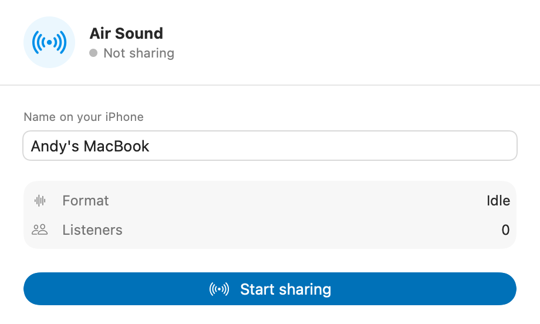
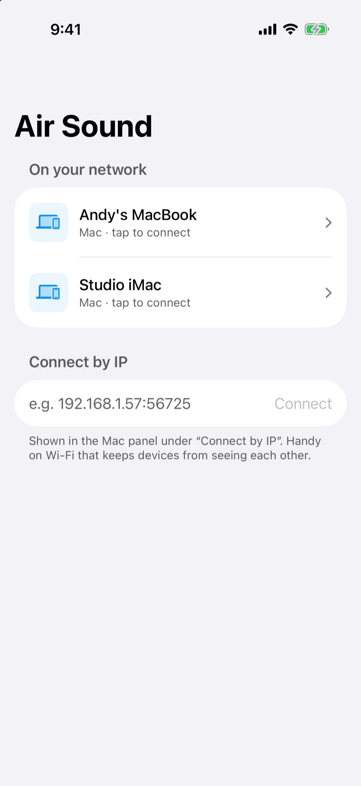

# Air Sound

Stream your Mac's **system audio** to your iPhone over the local Wi-Fi network.
Listen on the iPhone's speaker or on whatever headphones, Bluetooth, or AirPlay
device is connected. Route selection happens on iOS; the iPhone just plays what
it receives.

<p align="center">
  
  
</p>

**Download:** [macOS app](https://github.com/andyechc/air-sound/releases/latest/download/AirSound-macOS.zip) ·
[iPhone IPA for AltStore](https://github.com/andyechc/air-sound/releases/latest/download/AirSound-unsigned.ipa) ·
[Website](https://andyechc.is-a.dev/air-sound/)

The macOS build is ad hoc signed, not notarized. If macOS blocks the first
launch, open System Settings → Privacy & Security and choose **Open Anyway**.
The iPhone build is unsigned so AltStore can sign it with your Apple ID.

## How it works

```
┌─────────────────────┐          ┌──────────────────────┐
│  Air Sound (Mac)    │  TCP     │  Air Sound (iPhone)  │
│                     │ ───────► │                      │
│  Core Audio tap     │  Bonjour │  AVAudioEngine +     │
│  (_airsound._tcp)   │ ◄────────│  AVAudioPlayerNode   │
└─────────────────────┘  browse  └──────────────────────┘
```

- **Mac app** (`MacApp/`): lives in the menu bar, with no Dock icon. It creates
  a Core Audio *process tap* (`AudioHardwareCreateProcessTap`, macOS 14.2+)
  attached to a private aggregate device, excluding its own audio. The tap's
  Float32 stereo stream goes into a bounded ring buffer
  (`AirSoundCore.PCMFIFO`) and out over TCP to every connected iPhone, after
  one metadata frame (`StreamSpec`: sender name, sample rate, channels). The
  tap needs the **System Audio Recording** TCC permission; the app ships
  `NSAudioCaptureUsageDescription`, so macOS prompts on first Start.
- **iPhone app** (`iPhoneApp/`): starts its `_airsound._tcp` Bonjour browser on
  launch and again when the app returns to the foreground, connects as a TCP
  client, primes a jitter buffer (~110 ms), schedules chunks into an
  `AVAudioEngine`/`AVAudioPlayerNode`, and trims the backlog if the network
  stalls. Background playback uses `UIBackgroundModes: audio`; the
  local-network privacy keys are in its Info.plist.
- **Shared package** (`Packages/AirSoundCore/`): protocol constants, framing
  (`FrameReader`/`Framing`), `StreamSpec`, and the `PCMFIFO`, tested with
  `swift test`.

## Build & run

You need Xcode 16+ and [xcodegen](https://github.com/yonaskolb/XcodeGen).

```bash
# Regenerate the Xcode project after editing project.yml or adding files
xcodegen generate

# Command-line verification
xcodebuild -project AirSound.xcodeproj -scheme AirSoundMac \
  -destination 'generic/platform=macOS' build
xcodebuild -project AirSound.xcodeproj -scheme AirSoundiPhone \
  -destination 'generic/platform=iOS Simulator' build
cd Packages/AirSoundCore && swift test
```

For daily development, open `AirSound.xcodeproj` and:

1. Select each target and set your **Signing & Capabilities → Team**. The
   System Audio Recording grant persists across rebuilds only for a signed app.
2. Run **AirSoundMac**. Click the menu bar icon, press **Start sharing**, and
   accept the System Audio Recording prompt. Right-click the icon to stop or
   quit.
3. Run **AirSoundiPhone** on a real device on the same Wi-Fi, allow Local
   Network access, and tap your Mac's name. The simulator is useful for UI work,
   but a real iPhone is the audio path that matters.

If discovery is blocked by client isolation or a VPN, use **Connect by IP** and
the `host:port` shown in the Mac panel.

## Release builds

The published assets use fixed names so the website can link to
`releases/latest/download/...`:

```bash
# macOS, universal, ad hoc signed
xcodebuild -project AirSound.xcodeproj -scheme AirSoundMac -configuration Release \
  -destination 'generic/platform=macOS' \
  ARCHS="arm64 x86_64" ONLY_ACTIVE_ARCH=NO CODE_SIGNING_ALLOWED=NO build
codesign --force --deep --sign - path/to/AirSound.app
ditto -c -k --sequesterRsrc --keepParent AirSound.app AirSound-macOS.zip

# iOS, unsigned IPA for AltStore
xcodebuild -project AirSound.xcodeproj -scheme AirSoundiPhone -configuration Release \
  -destination 'generic/platform=iOS' CODE_SIGNING_ALLOWED=NO build
mkdir -p Payload && cp -R path/to/AirSoundiPhone.app Payload/AirSound.app
zip -qry AirSound-unsigned.ipa Payload
```

## Website

The landing page and privacy page live in `docs/` and are served by GitHub Pages
from `main` / `docs`. Screenshots in `docs/assets/` come from the DEBUG demo
seeds, so regenerating them never touches a live stream.

## Status: v1

- Audio is 2-channel little-endian Float32 at the Mac's device rate; the
  iPhone's engine converts to the output device.
- If the Mac changes output device mid-session, its sample rate may change;
  reconnect the iPhone (v1 snapshots the spec per connection).
- Latency is typically ~150 ms (jitter buffer + Wi-Fi), good for listening, not
  for production monitoring.
